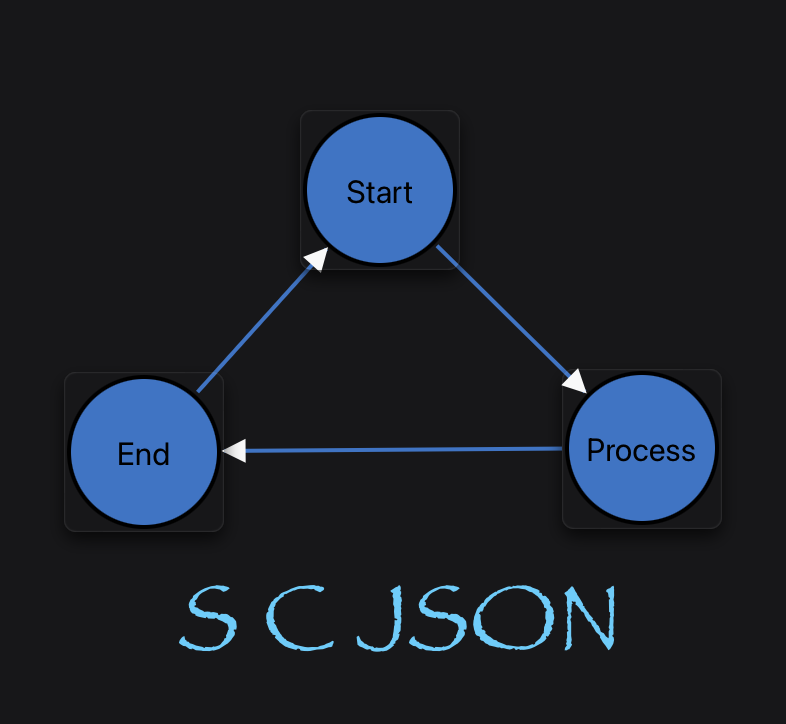

<p align="center"></p>

Agent Name: scjson-errata

Part of the scjson project.
Developed by Softoboros Technology Inc.
Licensed under the BSD 1-Clause License.

# scjson Errata Log

Living institutional memory for accepted scjson defects, ratified deviations,
and pre-existing infrastructure bugs surfaced while implementing a phase.
Inbound bug triage stays in GitHub Issues; entries cross into this file once
root cause + fix scope are agreed and the issue is accepted.

This log is governed by the parent `softoboros.com/CLAUDE.md` Spec-Before-Code
discipline (§ "Errata logs (per spec family)") and the scjson-local
discipline declared in `CLAUDE.md`. Entries are permanent — resolved entries
stay as historical record. Status icons:

- 🟢 resolved (fix landed + verification evidence cited)
- 🟡 diagnosed (root cause known + fix prescription written; not yet landed)
- 🔴 open (symptom reproduced; root cause unknown or contested)
- ⚪ deviation-pending-ratification (fix path identified, spec amendment in
  flight)

## Open Questions

(none — EOQ-001-ERRATA-002 resolved 2026-06-20: EXEC-E §EXEC-E-D1..D5 ratified the
bound — `max_candidates=2000` + `time_budget_ms=30000` defaults, construct-aware
depth reduction, terminal `limited` (partial vectors + `truncated:true`) on budget
exhaustion; `blocked` is owned by M1P6 D-M1P6-8, not by the search.)

## Index

| ID         | Status | Title                                           | First seen | Owning phase |
|------------|--------|-------------------------------------------------|------------|--------------|
| ERRATA-001 | 🟢     | scjson@0.4.0 TypeScript surface missing helpText | 2026-05-28 | CONV-E       |
| ERRATA-002 | 🟢     | Vector-generation BFS has no candidate/time budget — permanent hang on `<parallel>`+`<invoke>` machines | 2026-06-19 | EXEC-E (`SCJSON-EXEC-00-CONCEPTS.md`) |
| ERRATA-003 | 🟢 | Portable state membership in transition and conditional-action guards | 2026-06-20 | M1P6 D-M1P6-2 |
| ERRATA-004 | 🟢 | Inline JSON data becomes text in the Python engine and disappears from executable IR | 2026-11-21 | Python execution / M1P6 |
| ERRATA-005 | 🟢 | First-use foreach bindings have the expected values but the chart selects the wrong final | 2026-11-21 | EXEC-C |
| ERRATA-006 | 🟢 | Execution continues after a failing action inside foreach | 2026-11-21 | EXEC-C |
| ERRATA-007 | 🟢 | Converted SCJSON disagrees with XML on foreach action order and data witnesses | 2026-11-21 | EXEC-C / conversion |
| ERRATA-008 | 🟢 | The canonical Python model rejects authored literal send and donedata payloads | 2026-11-21 | Conversion / Python model |
| ERRATA-009 | 🟢 | Original ECMA execution cases select the wrong final in the 0.4.2 pilot | 2026-11-21 | EXEC-C |
| ERRATA-010 | 🟢 | Python qualification has reproducibility, fixture, and platform failures | 2026-11-21 | Python CLI / harness |
| ERRATA-011 | 🟡 | Conversion loses the authored order of parallel regions of different element kinds | 2026-11-21 | Conversion / execution |

---

## ERRATA-001 — scjson@0.4.0 TypeScript surface missing `helpText`

- **Status**: 🟢 resolved (v0.4.1 release; resolving commits 7476dea +
  65c1af6 + 976eedd; verification 2026-05-28)
- **First seen**: 2026-05-28
- **Owning phase**: CONV-E (`docs/concepts/SCJSON-CONV-00-CONCEPTS.md` §6
  "CONV-E: Help Text Schema Surface")

### Symptom

The published `scjson@0.4.0` npm package — and its in-repo source at
`js/src/scjsonProps.ts` and built artifacts under `js/dist/` — does not
declare `helpText: string[]` on any of the 26 CONV-E applies-to interfaces
(`ScxmlProps`, `StateProps`, `ParallelProps`, `FinalProps`, `HistoryProps`,
`InitialProps`, `TransitionProps`, `OnentryProps`, `OnexitProps`,
`InvokeProps`, `FinalizeProps`, `DatamodelProps`, `DataProps`,
`DonedataProps`, `ContentProps`, `ParamProps`, `AssignProps`, `LogProps`,
`RaiseProps`, `IfProps`, `ElseifProps`, `ElseProps`, `ForeachProps`,
`SendProps`, `CancelProps`, `ScriptProps`). The corresponding
`defaultXxx()` factories likewise do not initialize the field.

Verified at `HEAD = 22d890a` (2026-05-28) via:

```
$ grep -c "helpText: string\[\]" js/src/scjsonProps.ts
0
$ grep -c "helpText" js/dist/scjsonProps.d.ts
0
```

The Python side does expose the typed field — verified via:

```
$ python3 -c "import scjson.pydantic as p; print('help_text' in p.Scxml.model_fields)"
True
```

and the generator's introspected JSON schema does include `help_text` under
the 26 applies-to definitions:

```
$ python3 -c "
import scjson.pydantic as p
print('help_text' in p.Scxml.model_json_schema()['\$defs']['Scxml']['properties'])"
True
```

### Root cause

The TypeScript binding at `js/src/scjsonProps.ts` was last regenerated
before CONV-E (Help Text Schema Surface) landed on 2026-05-24 — i.e. before
`py/patch_help_text.py` was wired into `py/gen_models.sh` and before the
applies-to models gained the field. The Jinja generator template at
`py/scjson/templates/scjson_props.ts.jinja2` iterates
`schema["properties"]` and would emit `helpText: string[]` correctly if
re-run; the bug is that no one re-ran `python -m scjson typescript` after
CONV-E landed and before the v0.4.0 cut.

This is a release-process gap, not a template gap. The rust/ruby/swift
sibling files (`rust/src/scjson_props.rs`, `ruby/lib/scjson/types.rb`,
`swift/Sources/SCJSONKit/{ScjsonTypes,Models}.swift`) carry the same
staleness, but their fix is intentionally deferred to a future release per
the v0.4.1 brief's "no cross-language behavior changes" scope.

### Downstream impact

The Infinity Stack `iState` frontend (consumer of `scjson@^0.4.x`) cannot
complete its scjson-0.4.0 type-cutover because its `_generated/` interfaces
are derived from the scjson npm surface, and re-deriving currently elides
`helpText`. The consumer is carrying a temporary local `HelpTextInput` shim
pending v0.4.1.

### Fix prescription

Path (b) per the v0.4.1 implementation brief (preferred — TS-surface only):

1. Run `python -m scjson typescript --output js/src` to regenerate
   `js/src/scjsonProps.ts` against the current pydantic models. Expected
   diff: `helpText: string[]` added to each of the 26 applies-to
   interfaces immediately after `otherAttributes`; each `defaultXxx()`
   factory gains `helpText: []`.
2. `cd js && npm run build` to refresh `dist/`.
3. Verify acceptance: `grep -c "helpText: string\[\]" js/dist/scjsonProps.d.ts`
   returns `26`; `grep -c "helpText: \[\]" js/dist/scjsonProps.js` returns
   `26`.
4. JS converter round-trip is unchanged — `help_text` was already in
   `STRUCTURAL_METADATA_KEYS` per the CONV-E JS commit (`e1e3d1f`,
   2026-05-24). The TS surface gain is type-surface-only; converters
   continue to operate on snake_case JSON wire (Interpretation X per the
   brief). No converter semantics change.
5. Cross-language version-bump-only parity: `0.4.0 → 0.4.1` in
   `js/package.json`, `py/pyproject.toml`, `ruby/scjson.gemspec` +
   `ruby/lib/scjson/version.rb`, `rust/Cargo.toml` + `rust/Cargo.lock`,
   `java/pom.xml`. Non-JS packages have no behavior change.

Path (a) — exposing a regenerator CLI for downstream consumers — is
explicitly rejected for this release because (b) is structurally cleaner
(scjson owns its TS surface; downstream consumers should not reach into
scjson internals to regenerate).

### Verification

Verified on `main` at HEAD = `976eedd` (2026-05-28):

```
$ grep -c "helpText: string\[\]" js/src/scjsonProps.ts       → 26
$ grep -c "helpText: \[\]"        js/src/scjsonProps.ts       → 26
$ grep -c "helpText: string\[\]" js/dist/scjsonProps.d.ts    → 26
$ grep -c "helpText: \[\]"        js/dist/scjsonProps.js      → 26
$ cd js && npm run build                                     → exit 0
$ cd js && npx jest                                          → 112 passed / 112 total
$ cd js && npx tsc --noEmit tests/help_text_consumer.test.ts → exit 0
$ PYTHONPATH=py python3 -m pytest -q py/tests -p no:django   → 404 passed, 1 skipped
$ diff -q scjson.schema.json js/scjson.schema.json           → (no diff)
$ diff -q scjson.schema.json java/src/main/resources/scjson.schema.json → (no diff)
$ python3 py/uber_test.py                                    → exit 0 (Python + JS
  clean; lua/go/swift/java/csharp skipped for missing local executables)
$ grep -n "0\.4\.0" js/package.json py/pyproject.toml rust/Cargo.toml \
  java/pom.xml ruby/scjson.gemspec ruby/lib/scjson/version.rb           → (no match)
```

### Tracking

- Ratification: `docs/concepts/SCJSON-CONV-00-CONCEPTS.md` §11 entry dated
  2026-05-28.
- Resolving commits:
  - `7476dea` — docs(concepts): file ERRATA-001 + ratify v0.4.1 fix path
  - `65c1af6` — release(0.4.1): cross-language version bump + CHANGELOG entries
  - `976eedd` — release(0.4.1): regenerate TypeScript helpText surface
- Downstream: `softoboros/docs/todo/istate/TODO-ISTATE-08-HELP-TEXT-ADOPTION.md`
  §16 "ISTATE08b backend half landed; frontend half deferred to scjson
  v0.4.1" (2026-05-27 entry).

---

## ERRATA-002 — Vector-generation BFS has no candidate/time budget — permanent hang on `<parallel>`+`<invoke>` machines

- **Status**: 🟢 resolved 2026-06-20 (EXEC-E §EXEC-E-D1..D5 ratified the bound;
  fix landed in the EXEC-E vector-search-bound commit on this branch). EOQ-001-ERRATA-002
  resolved.
- **First seen**: 2026-06-19, during the iState-over-MCP codegen probe for the
  rlvgl SCTD-01 tutorial-demo effort (a faithful Dining Philosophers machine
  submitted to `istate_codegen_create target_langs=["rust"]`).
- **Owning phase**: EXEC-E — Vector Generation Phase 3
  (`docs/concepts/SCJSON-EXEC-00-CONCEPTS.md` §EXEC-E, currently open; acceptance
  item "EXEC-E vector-generation Phase 3 plan drafted before implementation" is
  unchecked).

### Symptom

A codegen job over the Alex Z tutorial Dining Philosophers machine
(`tutorial/Examples/StateCharts/DiningPhilosphersProblem/machine_dining_philosphers.flat.scxml`
— `datamodel="ecmascript"`, root `<parallel>` with ten children, five nested
`<invoke>` blocks each carrying an inline `<content><scxml>…</scxml></content>`
child machine, `<foreach>`, dynamic `<send eventexpr= targetexpr= delayexpr=>`)
sits in `STARTED` indefinitely — observed 30+ minutes with no `error`, no
`warnings`, no `artifacts`, no terminal transition. A trivial 4-state
`datamodel="null"` machine through the identical path SUCCEEDED in ≤14 s,
isolating the hang to machine complexity, not a generator outage.

The hang is in vector generation, before any Rust template is rendered. Pinned
against scjson `HEAD = 25c79d7` (2026-06-19):

- `py/vector_lib/search.py:82` — the `while frontier:` BFS loop. It is
  depth-capped (`py/vector_lib/search.py:84`, `if len(seq) >= max_depth`) but
  has **no candidate-count cap and no wall-clock budget**; every candidate that
  increases coverage is appended to the frontier (`search.py:100-101`), so
  breadth grows ~`|alphabet|^depth`.
- `py/vector_gen.py` — each evaluated candidate calls a `ctx_factory()` that
  re-instantiates a fresh `DocumentContext.from_json_file(...)`. For this chart
  that means re-entering all parallel regions and starting five
  `SCXMLChildHandler` instances from inline `<content>` SCXML on **every** node
  visited.

The combination — large event alphabet × `max_depth=4` (the value the iState
caller passes, `backend/istate/codegen/vectors.py:60`) × an O(parallel × inline-
invoke child-machine init) per-node cost — makes the search effectively
non-terminating in practical wall-clock. (Runner-up, not yet excluded: a single
`ctx_factory()` blocking inside the child-invoke `_pump()` for a machine whose
inline children never quiesce.)

### Root cause

`generate_sequences` bounds only search *depth*, never *breadth* or *time*, and
the per-candidate context construction is unexpectedly expensive for machines
that combine a root `<parallel>` with inline-`<content>` `<invoke>` children.
EXEC-E (parallel/invoke corpus expansion + vector minimization) was never
drafted, so no committed bound exists; the defaults in
`generate_sequences(... max_depth=2, limit=1)` are the only guard, and the
iState caller overrides `max_depth` to 4. There is no terminal "search exhausted
the budget" outcome, so the only signal a too-complex machine produces is an
indefinite `STARTED`.

### Downstream impact

- iState codegen (`istate.codegen.generate`) inherits the hang and never
  reaches a terminal job state — see the reciprocal istate-side entry
  `softoboros/docs/todo/istate/ERRATA.md` ERRATA-006 (missing codegen watchdog +
  shallow context builder).
- rlvgl SCTD-01 (faithful tutorial-machine demo) is blocked on this:
  `ops/packer/submodules/rlvgl/docs/concepts/SCTD-00-CONCEPTS.md` §8 names iState
  MCP as the generation authority, and the tutorial machines cannot be generated
  until the search is bounded.

### Fix prescription

EXEC-E (spec first, per scjson `CLAUDE.md` — this changes cross-language trace
generation behavior):

1. Add a committed bound to `generate_sequences` in `py/vector_lib/search.py`:
   a candidate-count cap (e.g. `max_candidates`) and a wall-clock budget
   (`time_budget_ms`), checked at the top of the `while frontier:` loop, plus
   a construct-aware depth/alphabet reduction when the chart contains
   `<parallel>` and/or `<invoke>` (detectable from the doc before the search).
2. Define the terminal outcome of an exhausted/over-budget run: emit a
   `limited` result carrying whatever partial vectors were found plus a
   `truncated: true` marker, **or** a `blocked` result with an explicit reason
   — the choice is EOQ-001-ERRATA-002, to be ratified under EXEC-E.
3. Ensure `ctx_factory()` reuse / memoization where safe, so repeated node
   evaluation does not re-pay full inline-`<invoke>` child-machine
   initialization for an unchanged prefix.
4. Cross-check: the trivial null-datamodel baseline must stay byte-identical
   (no churn in existing golden vectors); add a regression vector from a small
   `<parallel>`+`<invoke>` machine that completes under the new budget.

The reciprocal istate-side watchdog (ERRATA-006) is belt-and-braces: even with
this fix, the codegen Celery task MUST carry an effective per-task time limit so
no future construct can park a job in `STARTED` forever.

### Verification

✅ 2026-06-20. `generate_sequences`/`generate_vectors` now carry `max_candidates`
+ `time_budget_ms` budgets checked at the top of the BFS loop, plus EXEC-E-D2
construct-aware depth reduction and a `truncated` marker. Evidence:
(a) the Dining Philosophers machine now **terminates in ~39 s** with 22 partial
sequences and `truncated: true` (was an indefinite 30+ min hang);
(b) the existing null-datamodel golden vectors are byte-identical — full scjson
suite **480 passed / 1 skipped** (baseline 410/1 before the EXEC-E + ecmascript
work, all prior tests still green);
(c) a new bounded `<parallel>`+`<invoke>` regression machine (`test_vector_search.py`)
completes under budget at effective depth 2. Memoization (EXEC-E-D3) deferred with
a TODO per spec (optional for first landing).

### Tracking

- Owning phase: `docs/concepts/SCJSON-EXEC-00-CONCEPTS.md` §EXEC-E (to be
  drafted with the bound decision + EOQ-001-ERRATA-002 resolution).
- Reciprocal istate entry: `softoboros/docs/todo/istate/ERRATA.md` ERRATA-006.
- Downstream demo: `ops/packer/submodules/rlvgl/docs/concepts/SCTD-00-CONCEPTS.md`
  §8 (iState MCP generation boundary).

---

## ERRATA-003 — `In()` cross-region predicate not in the admitted ECMAScript subset

- **Status**: 🟢 resolved on `v0.4.3` and in the iState executable-IR Rust generator. Docker VM verification completed 2026-11-21.
- **First seen**: 2026-06-20, lowering `tutorial/Examples/Qt/SkodaBoleroInfotainment/Model/bolero.scxml` through `exec_ir.lower_document`.
- **Owning phase**: M1P6 (`docs/todo/scjson/TODO-SCJSON-SCRIPT-M1P6.md` §"Admitted ECMAScript Subset", D-M1P6-2).

### Original symptom

In the original Qt Bolero chart, `mediaPlayerSourceCheck` selects play or
pause by checking `muteOff` and `muteOn` in another region. On entry,
`mediaStopped` checks `mediaRepeatTrack` to choose play or next track.
`mediaPlaying` checks `mediaPlayerScanModeOn` to schedule a delayed forward
command. The 0.4.2 generator lowered the membership calls to unsupported
expressions. A bare guard could never take its branch, and negation could
make an unsupported guard succeed.

### Root cause

The original D-M1P6-2 whitelist omitted the SCXML membership predicate.
Generated guard evaluation could read the datamodel and event, but had
no access to the current session's active configuration.

### June 2026 disposition

- **Now (workaround, used for SCTD):** normalize the machine — replace `In(<region-state>)` checks with explicit datamodel state variables that mirror the orthogonal-region intent (e.g. `s_mute`/`s_repeat`/`s_source`), an admitted D-M1P6-2 form. This is the SCTD-00 §5.3 normalized-form path with provenance back to the upstream source; it is how the SCTD "Media Player" machine is produced (a normalized media-player derived from Bolero, lowering with 0 diagnostics).
- **Future (real fix):** extend the admitted subset to support `In(<stateid>)` as a `cond`-context predicate, lowered to a runtime configuration-membership check (the runtime already tracks the active set). This is the path to lowering the **real** Bolero control core. It is an admitted-subset change → a M1P6 D-M1P6-2 amendment (Specification Required) + a new scjson generator phase; out of scope for v0.4.2.

### Historical verification

The normalized media-player fixture lowered with zero diagnostics and
passed `cargo check` for the SCTD demo on 2026-06-20.

**Open at the 0.4.3 package boundary.** At `76ab694`, the original Bolero
chart has 40 literal `In()` calls across 29 guard sites. A parallel-region
probe distinguished the existing interpreter from generated Rust. Both
could identify the active leaf and its ancestors directly, but the generated
positive and negated guards selected the wrong branches. A lowerer must
carry the current session's configuration into guard evaluation, including
conditional actions. The next D-M1P6-2 amendment should specify the admitted
argument, evaluation timing, and unknown-state behavior, then test those
choices against compiled code on both source routes. Host probe SHA-256
`2c448429605fe8cf0d03bfe057f1b34ec076b264c050b860ad6a62bdfb7475a8`.

### Tracking

- Admitted-subset owner: `docs/todo/scjson/TODO-SCJSON-SCRIPT-M1P6.md` D-M1P6-2 (a reciprocal note records the `In()` gap + the normalized-media-player conformance decision).
- SCTD consumer: rlvgl `docs/concepts/SCTD-00-CONCEPTS.md` §5.1/§5.3 (Media Player = normalized, provenance to bolero).
- Also surfaced: radio helper functions stored as `<data expr="function(){…}">` (JS function-literals) are likewise outside D-M1P6-2; same normalize-or-extend disposition.

### Verified repair on 2026-11-21

The D-M1P6-2 amendment in parent commit `6a3e06e94` admits
`In('stateId')` in transition, `if`, and `elseif` conditions.
The lowerer emits an existing `CallNode` with a single string literal.
The generated Rust runtime checks the entered states of the instance
executing the guard. The Python and Rust engines select transitions
before exits. Their exit handlers, transition actions and entry handlers
see the configuration at their respective points in the microstep.
An unsupported operand disables the whole guard, including under negation.

The docker-vm matrix used scjson `2a9c9eb2bc9f98836a961f2294830090f5ec3925`
and iState `ccbf0b585b7cf1c1897948ca99e98a99c36f56ac`. The XML and
canonical SCJSON inputs produced byte-identical generated crate members for
all 25 charts. Each route compiled and executed its own crate.

| Witness | Results on both input routes |
| --- | --- |
| Original Alex Z tutorial tests | All 15 charts containing membership guards reached the authored `pass` in Python and Rust. Three single-edit controls reached `fail`. The census covered 440 SCXML files at tutorial commit `a442d41e`. |
| Bolero guard coverage | 28 admitted guards, 38 calls, 84 combinations. Both engines matched the independently computed truth table. The remaining guard has two calls in an unsupported ternary and was rejected. On the baseline Rust missed 56 of the 84 combinations on each route. |
| Bolero media source | Three original state elements were copied into an isolated controller. The original valid-source event reached `mediaPlayerDoPlay` when unmuted and `mediaPlayerDoPause` when muted. |
| Whole Bolero | The original XML and corresponding SCJSON compiled. When pending startup events were serviced before external input, Python consumed `error.execution` and reached `fail`. Rust remained in the five startup leaves and reached the radio configuration on power-on. The raw Qt chart depends on unimplemented host/script behavior. |
| SoS | The counter and guarded-transition charts matched their five scenarios in both engines. The independent native runner passed its seven vectors and rejected an altered tick count. |

The Python wheel is `scjson-0.4.3-py3-none-any.whl`, SHA-256
`bea391cba142d5e81ac46bcbf02c160205f5245b7d0c3246b0d40c6168ff578e`.
The full Python suite passed 779 tests on Linux with two optional skips,
and 778 tests on Windows with three optional skips. The focused docker-vm
gate passed 52 upstream tests and 26 iState emitter and compatibility tests.
The final matrix receipt SHA-256 is `4a938815bdc325868cf891feb66bdf5210ead5f6c1f941031c4513099d15bc3d`.
Python and Rust each passed all 112 scenarios with expected results on each
route. The internal-event-first whole-chart trace is recorded separately.
The generated crates and their run inputs are in the parent project's
`.aws-release/scjson-ir-membership-20261121/state-membership-generated-rust-review.zip`,
SHA-256 `bb0b0cb763bf55590bb41339308f89733add51326eec4a4b244d3fd316b69573`.

**Consumer observation.** Interactive Dining's original five `break.N`
transitions default to external. They can exit and reenter other regions,
which breaks one of seven existing expectations. A disposable copy declaring
those five transitions internal passed all seven original tests on docker-vm.
The review packet includes the exact patch. ERRATA-011 records a separate
loss of structural region order that can affect membership during entry.

---

## ERRATA-004 — Inline data initialization in the Python engine and executable IR

**Resolved on the Python `v0.4.3` branch.** First reproduced on 2026-11-21
with published version 0.4.2, tag `1363d3e`. Package publication is a
separate release action.

**Symptom and root cause.** Original Alex Z test 155 declares an inline array
at `tutorial/Tests/ecma/W3C/Mandatory/Auto/test155.scxml:8`. The converter
stores the characters, including indentation, in the declaration's
`content` list. On 0.4.2, `py/scjson/context.py:2249` wrapped those strings
on both file routes and `context.py:562` joined the Python representations
of those wrappers. The direct validated-model route joined the original
strings. Both paths gave foreach a string to iterate. The file routes
left `Var2` equal to the closing brace of a dictionary representation.
Separately, `py/scjson/exec_ir.py:1133` read only the declaration's `expr`
attribute. The inline slot therefore had no initial value. Expression
collections could also silently lose unrepresentable members, including
signed numbers.

**Fix and downstream impact.** Commit `b0a9a372af55e06256bd9a26d9a3e9cfa147a3c0`
preserves character-data parts on file intake, decodes inline JSON once at
initialization, and uses the same value in the IR. The IR keeps complete
constant collections and leaves a collection with a dynamic member unknown.
Authored character data survives the XML round trip. iState removed its
inline-to-expression vector rewrite in `2a4f6c4174ce8b3cc536ab2c59d66229394a6250`.
[Python engine guide](../ENGINE-PY.md#overview)

**Verification.** With the pinned tutorial submodule initialized, run
`PYTHONPATH=py python -m pytest -q py/tests/test_engine.py py/tests/test_exec_ir.py`.
The original ECMAScript and Python 155 files both reached `pass` via
`from_xml_file` and `from_json_file`, with `Var1 = 6`, `Var2 = 3`, and
`Var3 = [1,2,3]`. Changing the last element to 4 gave `fail`, 7, and 4.
The 23 conversions in the Docker VM comparison were byte-identical between
versions. Both SoS charts matched through both routes and all seven native
SoS vectors passed. See the regression tests
`test_inline_foreach_original_155` and `test_original_155_lowers_inline_collection_and_loop`.

| Qualification artifact | SHA-256 |
| --- | --- |
| Python 0.4.3 wheel | `91aa75003aa3ddee81ad7f50265cced68dcbc905d974cd582d0243cb4f0628f5` |
| Docker VM 0.4.2 baseline evidence | `c7fea263cf59b64804d2ce154147c4ba85fe5f40c3d44d45262a55c534553262` |
| Docker VM 0.4.3 upstream evidence | `f45c01d6f5eeeb84dcee5d0e5bf1214177a86a4983e4ee5f40619ca3610e07a2` |
| iState generated-code review ZIP | `5fc281610a9ec1fe882a7d8c2c70ee61e0b0b6847f9061ee1a6a35bc18b1ceed` |

The three entries below use the same two VM receipts and Alex Z Tests tree
`aa46a43361f6281a70d0809e45a3ce3dd906c486`. Across 20 original foreach
charts, counts matching the authored final **and** selected data fields rose
from 8 to 14 on XML and from 4 to 8 on SCJSON. Each open entry requires a
fix and a regression test in both dialects.

## ERRATA-005 — First-use item and index bindings reach the wrong final

**Resolved, EXEC-C, 2026-11-21.** Tests 150 and 151 failed through XML and SCJSON on 0.4.2
and on `b0a9a37`. On 0.4.3 the last declared and first-use item/index
pairs both equal `(3, 2)`, yet both charts select `fail`. Their final
guards read the newly introduced item and index respectively. At entry to
`s2` the guard evaluated to 3 or 2. The old guard handler required a Boolean
instance, queued `error.execution`, and selected the unconditional fallback.

Commit `d0cb3791aeeb951297ad54d9cbc862a4c13e41ff` applies datamodel
truth testing after sandbox evaluation. On docker-vm the untouched ECMA
and Python 150 and 151 charts passed on all eight XML and SCJSON routes
with both pairs intact. Numeric zero took the fallback without an error.
A missing variable and original invalid-condition test 344 retained their
error event. Both SoS charts and all seven native vectors passed.
The 20-chart final-and-data counts improved from 14 to 18 for XML and
from 8 to 12 for SCJSON. All previous passes were retained.
[SCXML conditional expressions](https://www.w3.org/TR/scxml/#ConditionalExpression)

| ERRATA-005 verification | SHA-256 |
| --- | --- |
| Baseline VM evidence | `c3c10ebdf8393c942f2b6435e9fd0c72d599a7c7c7eae028bed0694258a5af1d` |
| Qualified Python 0.4.3 wheel | `f6c19292c1744a58aed718ce7af3fea330e6805af7a1086a529a78c7bfd9c104` |
| Candidate VM evidence | `b8d8cc6d1556025dd36128e6d40ad583140a36efad01b2e097dc00de5e9a6564` |

## ERRATA-006 — An action failure inside foreach leaves later iterations running

**Resolved, EXEC-C.** In original mandatory test 156 the body increments
`Var1`, then attempts `<assign location="Var5" expr="return"/>`. On
`b0a9a37` the XML and SCJSON engines finish at `fail` with counter and
last item both equal to 3. The chart expects the loop to stop on the first
error. At `961f7e1`, both dialects and both file loaders select `pass` with
counter and last item equal to 1. The valid control visits all three items.
Test 159 preserves the variable that follows a failed send and delivers
`error.communication`. All 20 block-boundary tests passed on docker-vm.
The VM evidence archive has SHA-256
`9a25ce9edc887b4d99837f045620d711bf26ff2f0ef0dcd9672561717171312f`.

The broader sweep also exposed earlier false passes in ECMA 460 and 525
and Python 525. The old engine stored a failed assignment's source text.
The corrected engine leaves the previous collection intact on failure.
The ECMA array operation and original Python type error have separate
regression coverage.

## ERRATA-007 — Converted SCJSON loses behavior in three original foreach charts

**Resolved, EXEC-C / conversion.** In both original dialects on `b0a9a37`,
XML matches the expected state and fields. Normal SCJSON conversion followed
by strict JSON-file execution gives the observations below.

| Alex Z test | XML | Converted SCJSON |
| --- | --- | --- |
| 153, conditional assignments inside foreach | `pass`, `Var4 = 1` | `fail`, `Var4 = 0` |
| 457, invalid bindings followed by a valid loop | `pass`, `Var6 = 6` | `fail`, `Var6 = 0` |
| 459, ordered values with an index | `pass`, `Var5 = 1` | `pass`, `Var5 = 0` |

Grouping actions by kind erased the interleaving of assignments, other
actions, and conditional markers. The optional `execution_order` list now
preserves that information. Original 153, 457 and 459 select `pass` through
both loaders in both dialects, with `Var4 = 1`, `Var6 = 6`, and `Var5 = 1`
respectively. The first VM run found three failures when an absent field
serialized as null on Pydantic 2.11.7. At `a9b82e9` all 34 order checks
passed on that version, including legacy documents and explicit empty lists.
See the [wire contract](SCJSON-CONV-00-CONCEPTS.md#executable-child-order-errata-007).

On docker-vm the packed JavaScript converter from `bc58fae` converted and
restored 47 original and SoS charts. Python independently executed both
returned forms of 150, 151, 153, 155, 457 and 459 in both dialects. All
24 final-and-data checks passed. The tarball has SHA-256
`1ab72f3bd0113ac15a20b34662094eec780f957616b7c1cb47e9bb8bef485890`.
The packed-converter VM evidence has SHA-256
`8f040e6692f2ae030610de72f94900d2441d3bb29c4ccb7ed3b99d4a00cebecf`.

## ERRATA-008 — Literal send and donedata payloads fail canonical validation

**Resolved, conversion / Python model.** On 0.4.2 the converter returns
literal character data for `<send><content>` and `<donedata><content>`.
At `py/scjson/pydantic/generated.py:93`, `ScxmlContentType.content` expects
a list of nested charts. Direct validation of the converter's SCJSON therefore
rejects the first string, including valid ordinary text, digits, multiline
text, and JSON-shaped text. ERRATA-004 concerns the separate `<data>` type.

The pinned Alex Z census found 17 such roots in the Tests tree identified
in ERRATA-004. These are the two ECMA Custom/types
`testConditionalExpressions*` charts, both dialects of mandatory 179,
354 and 529, ECMA mandatory 294, and both dialects of optional 520, 532,
562 and 578. The separate malformed Python 401 assignment and the ECMA
`test-enc-UTF8` root transition account for the other two intake refusals.
Replaying all 19 on both package versions produced byte-identical intake
results, SHA-256 `6775c9ffd2b163e0daa7a5d0d81577501c1825ac5d46ba14d95428f9da5199a5`.

Commit `bf1f852` preserves literal text, qualified XML elements, and inline
charts in the canonical payload model. All 17 originals passed intake,
model and schema validation, and literal round-trip checks on docker-vm.
The focused tests also checked whitespace, nested markup, actual send and
done data, child completion, and the two independent malformed inputs.
The combined ERRATA-007/008 run at `a9b82e9` passed all 82 focused checks
and the SoS controls. The tested wheel has SHA-256
`c4e01488d8521c1ac6ddccd2500477e64d4d09e4bd850d7e9bd9c331dfbb6cf9`.
The VM archive has SHA-256
`0c1ee9f9bff0cf73ca1f22dca83d67892c558f0ba024c6e89671e9f369163b96`.

An XML parser independently compared all 17 original payload literals with
the XML restored by the packed JavaScript converter. Every string matched.
Rust 1.85.1, Ruby 3.3.14 and Swift 6.2.4 also decoded and encoded a sparse
chart with text, qualified markup, an inline chart, an omitted order, an
explicit empty order and repeated conditional markers. Native binding
evidence SHA-256
`b60336985d1c0826e38431402af6b7aea5af0ca5ec0e0bb60bddc9aec3439189`.

The final wheel at `76ab694` admitted 425 of 427 Alex Z root charts on
docker-vm, up from 408. The run verified the original hashes of all
440 files and excluded the same 13 invocation helpers. All 17 newly
accepted roots are the payload cases above. Every previously accepted
root still validated. Intake evidence SHA-256
`d13f3dfcceeb229f337d640ec2738768e95fb41a9113a077f2d7ee94e0f85af6`.

## ERRATA-009 — Original execution cases select the wrong final

**Resolved, EXEC-C.** The initial 0.4.2 Docker VM pilot ran 14 original ECMA
mandatory automatic charts, each in both strict and lax mode. Seven selected
`fail` where the chart expected `pass`. Case 151 is tracked in ERRATA-005.
Case 570 passed the subsequent control that drained immediate work before
advancing the clock. Retain that scheduling order in future runs.

| Case | Executable requirement to reproduce and fix |
| --- | --- |
| 159 | An error in a send skips subsequent actions in the executable block. Capture the following assignment and the pending error event. |
| 173 | A send uses the current value of `targetexpr`. Record the evaluated destination and delivered event. |
| 216 | Invocation uses the current value of `srcexpr`. Supply the original child file and check completion in the parent. |
| 404 | Exits run child before parent, with reverse document order for ties. Capture the actions in order. |
| 500 | The SCXML event I/O processor exposes its location. Record the value read by the authored guard. |

At `a7592d18111c12e472a7098ea02d6a4faa414171` the five cases and
timing control 570 passed in both dialects on both XML and SCJSON entry
points (24 observations). In 159 the failed send left the counter at
zero. In 173 the event reached `#_internal` after the target variable
changed. In 216 the parent loaded the original sibling file and received
`done.invoke` before the timeout. In 404 the exit and transition actions
raised `event1`, `event2`, `event3`, and `event4` in order. In 500 the
authored expression returned the registered address of its own session.
Separate controls verified self-addressed delivery and distinct session
addresses. A nonempty string containing the unevaluated expression had
previously made the guard in 500 pass.

The same VM run matched the authored foreach final and data on 19 of 20
originals through each loader. In ECMA 460 and 525 the collection became
`[1,2,3,4,4,4]` in exactly three iterations. Python 525 evaluates
`Var1 + '4'` with a list on the left. Its first assignment raises a type
error and correctly leaves the counter at zero and the list at `[1,2,3]`.
The original chart therefore selects `fail`. All four SoS file routes
and seven native vectors passed. VM evidence SHA-256
`6b379f1d98f1a26858ad2b249a5105e46fe8d2bb3fc5b76fc5678fe2ae0ed2e6`.

**Closure.** Carry each row independently. Establish the first discrepancy
with its original companion files, then require the authored final and the
intermediate observation in the table. Preserve 570 as a passing control.
The original pilot result has SHA-256
`8ea277ae7dac00910f5f2d20d28f0e9e7a1936b442bb329f1e3bac1322dad9ce`.
The bounded Windows replay of both releases on the original schedule ran
56 checks (14 charts × two modes × two versions). Each group retained
the same seven passes and seven failures. No process timed out. Replay
SHA-256 `8ed4e0a83ebf7d063f69e1fb356ba1d3337acb4782ca54f9a5db14a8626facbd`.
The separate two-schedule replay on each wheel reproduced the distinction
between 216 and 570. The 0.4.3 timing receipt has SHA-256
`119ad0e234302bfd0c39fdd28570272ddb992b566f971d9213e9b8e558d6d41e`.

## ERRATA-010 — Qualification fixture, CLI, and platform failures

**Resolved, Python CLI / harness.** Running `python -m pytest -q py/tests`
on Windows against `b0a9a37` produced 567 passes, 17 failures and three
skips. Every failing test reproduced on baseline `d04ae8f` at the same
assertion with the same failure signature. The eight affected test modules
matched between revisions. The targeted baseline comparison has SHA-256
`8bb2fd18ad3f8be85e4fcba32365aaecbf673bf605ba0764e7812439f450fac1`.
Track these independently of the runtime cases above.

| Affected checks | Reproduction and fix target |
| --- | --- |
| Three `test_cli.py` recursive conversion, validation, and verification tests | The first conversion exits 1 with `FileNotFoundError` at the original temp path. A shorter pytest temp root recovered conversion and validation. Verification then reached line 163 and misread the original XML using the host encoding. All five sampled originals parsed with explicit UTF-8 BOM handling. Check both path length and encoding on Windows. |
| Nine reference-launch cases in `test_exec_compare_advanced.py`, `test_exec_compare_integration.py`, `test_exec_sweep_integration.py`, and `test_uber_conv_corpus.py` | `_build_trace_cmd` loses backslashes when a Windows interpreter path is parsed as unquoted POSIX shell text. Preserve argument boundaries and rerun each comparison, including paths with spaces. |
| `test_xinclude_resolve_mode_converts_assembled_tree` | A drive-letter parent path resolves to bare `child.scxml`. Resolve relative includes against the actual document directory and check both preserve and resolve modes. |
| Swift source check in `test_conv_h.py` | The Swift submodule was absent. Initialize the pinned fixture for qualification and distinguish an unavailable checkout from a binding failure. |
| `test_uber_test_runs_focused_conversion_corpus` | The redirected Windows CLI banner cannot encode the arrow. The harness skips the converter and later misses its output. `PYTHONUTF8=1` made the unchanged test pass. Check CLI output encoding and make converter startup failure visible. |
| `test_payload_heuristics_chained_range` and `test_exec_sweep_small_corpus` | The inline test fixture and `tests/sweep_corpus/range.scxml` both contain raw less-than signs in an XML attribute. The unit test stops at parsing and the sweep misses its coverage row. Correct the test-owned XML fixtures and require an actual coverage row and payload assertion. |

Close each row with the affected test IDs, platform, interpreter, result,
and any required test dependency. Keep individual outcomes visible when a
common fix clears several checks.

Two Windows recovery runs isolated setup effects. The three recursive CLI
tests passed with a shorter pytest temp root and `PYTHONUTF8=1`. The three
maintained-binding checks passed after initializing Swift at the recorded
gitlink `38b5c24d3c7777d9c7287b9020d4e0885685a29c`.

On docker-vm the same wheel passed the full Python suite with both the
tutorial and Swift gitlinks populated: 585 passed, zero failures, two
optional SCION comparisons skipped because SCION was unavailable. The
one failure in the preceding Linux run was the missing Swift fixture.
All 587 test IDs matched between runs. Full Linux evidence SHA-256
`fe47b20e7552c574eb8069a9094dd089ce677f81ca2aba9fcc3062c790a2fa6f`.

The portability repair runs reference commands with platform-native argument
boundaries, uses the Windows extended path form for recursive conversions,
and resolves local XInclude file and directory URIs. The two chained-range
fixtures now encode their XML attribute correctly. The Windows run repeated
all 17 failing test IDs plus three tests for argument quoting, deep paths,
and relative includes. All 20 passed. The full standalone Python run passed
587 tests and skipped three optional SCION and Ruby checks. The Linux
portability run passed all 11 selected tests with the same source changes,
including a real reference process and generated conversion and sweep files.
Its verified evidence SHA-256 is
`e33bd1fffbc89a9d1e2f29c08893acc4819e970fb48e82082badf57cee25b187`.

### Final 0.4.3 package qualification for ERRATA-005 through ERRATA-010

Implementation commit `76ab694fe1ddfc08de8d53cd97d1bd01f46497f3`
passed 718 full-suite tests on Linux and 717 on Windows. Both skipped two
optional SCION comparisons. Windows also skipped the Ruby CLI comparison.
The independent Ruby binding test ran on docker-vm. The final semantic run
passed 111 focused checks, all 24 adjacent-case checks, both SoS charts
through both loaders, and all seven native vectors. The final packed Node
rerun used the same Python wheel for its returned-file execution checks.

| Artifact or result | SHA-256 |
| --- | --- |
| Python wheel | `4a5ac91456755725607908b92772007528a18f703b299c23dc7cfee2d82c90a4` |
| npm tarball | `1ab72f3bd0113ac15a20b34662094eec780f957616b7c1cb47e9bb8bef485890` |
| Linux full-suite archive | `26f1716e6225c4c25c382170097a22ac6783fe82b81af7e69bbfb64917b1bc46` |
| Windows full-suite result | `ba250c56f0ec1207425cc103ea0403cb5376220af279ba28b8286dcef61b237b` |
| Final semantic archive | `f23ef65c039072349af10a3a1e4538841e33aa52d59a83275e029d1175b722d2` |
| Final packed Node archive | `ee58b74a2df668fd509b05394a66997c4c85cc2f0ff3b9b661ef54854cf9f886` |
| Combined package and review ZIP | `207e2197310324c92ba2e554ab89b20062c57701f6005417cc7484907741cc6e` |

## ERRATA-011 — Structural order of mixed parallel regions

**Diagnosed on 2026-11-21 at Python 0.4.3 candidate `2a9c9eb`.**
Two XML charts reverse a nested `<parallel id="first">` and a sibling
`<state id="second">`. Their canonical SCJSON is byte-identical,
SHA-256 `ffb067a26c81a34af68536195446b46c200276c54649161d743b659603c10c59`.
The structural model collects children by kind. Both file loaders enter
`second` before `first`, including when the author placed `first` first.
Consequently an entry action in `second` that tests `In('first')` misses
its authored effect. Both charts reach the same final set of active states.

In the Alex Z corpus, the original `testDoneParallelThreeLevels.scxml`
still reaches its authored `pass` outcome through both loaders. Detecting
the defect requires checking the order of effects during entry.
The repair needs lossless structural document order in conversion, model
loading and execution, plus a read rule for existing SCJSON. ERRATA-007
covers the order of executable children. The new order witness, both
serializations and the original's observations are recorded in the
ERRATA-003 review packet under `review-extras/mixed-structural-order/`.
Host result SHA-256 `91a22a9a1268029db55029c533fef3ebe061a783c65efa989f44fb718b8a0b0e`.

---

## How to add an entry

1. Pick the next sequential `ERRATA-NNN` id.
2. Add a one-line row to the index table above with the title, status icon,
   first-seen date, and owning phase.
3. Add a new `## ERRATA-NNN — <title>` section after the existing entries
   with the canonical shape: Symptom (pinned to HEAD at first-seen time with
   `path:line` cites), Root cause, Downstream impact (if any), Fix
   prescription, Verification (resolving commit + evidence), Tracking
   (related phase docs / §11 cross-refs).
4. If the entry has an open question requiring user input or ratification,
   add it to the "Open Questions" section above with the stable handle
   `EOQ-NNN-ERRATA-NNN: <one-line ask>`.
5. Entries stay after resolution — flip status to 🟢, fill in Verification,
   and do not delete.
